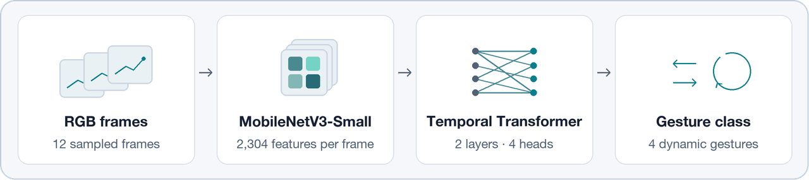

# Haoran Xu

**M.S.E. student in Electrical and Computer Engineering at Johns Hopkins University**

Computational imaging · Biomedical sensing · Robotics

[Projects](#selected-projects) · [Current work](#current-work) · [Research](#research-and-engineering-experience) · [Toolkit](#technical-toolkit) · [Education](#education)

I’m interested in how signals and images can be used to measure physical processes and control devices.

## Selected projects

### Video gesture recognition with CNN + Transformer

This PyTorch project classifies four gestures from RGB clips. I evaluated the Transformer and two baselines on participants held out from training and validation. I also shuffled the frame order to test how much the classifier relied on temporal information.

**[Explore the model and results →](projects/gesture-recognition.md)**

<picture>
  <source media="(prefers-color-scheme: dark)" srcset="./assets/gesture-pipeline.png" />
  <source media="(prefers-color-scheme: light)" srcset="./assets/gesture-pipeline-light.png" />
  
</picture>

### Quadcopter–pendulum control simulation

I worked on MATLAB and Simulink models for state feedback, observer-based control, and discrete-time implementation. The project includes waypoint-tracking simulations for a quadcopter carrying an inverted pendulum.

## Current work

<table>
  <tr>
    <td width="50%" valign="top">
      <strong>Reproducible image deblurring</strong>
      
I compare FFT-based Tikhonov regularization and total variation solved by ADMM. I use held-out images, numerical solver checks, and paired noise experiments to evaluate reconstruction quality with PSNR and SSIM.

    </td>
    <td width="50%" valign="top">
      <strong>LingShu Intelligence Studio</strong>
      
I founded a student-led studio in 2025 to build prototypes in embedded systems, multimodal sensing, and assistive robotics.

    </td>
  </tr>
</table>

## Research and engineering experience

- **Blood-flow estimation with diffuse correlation spectroscopy** · Undergraduate research, 2025–2026. I estimated blood-flow indices from optical autocorrelation measurements and compared three estimators across photon counts, sampling rates, and noise conditions.
- **Cable-driven hand exoskeleton** · Team lead, 2025. I led development of a stroke-rehabilitation prototype that combined forearm sEMG, bend sensors, and 3D-printed actuation components. I trained a CNN–Transformer to classify gestures from sEMG signals.
- **EMG-controlled 6-DoF robotic arm** · Summer research fellowship, 2024. I developed an EMG filtering and classification pipeline and integrated MPU6050 inertial measurements for motion tracking.
- **GaN and metal-oxide device fabrication** · Micro/nano laboratory, 2026. I fabricated GaN MIS-HEMTs and metal-oxide thin-film transistors, then characterized their electrical and light-pulse responses.

## Technical toolkit

| Area | Tools |
| --- | --- |
| Scientific computing and vision | Python, NumPy, SciPy, PyTorch, OpenCV |
| Embedded systems and control | C/C++, MATLAB, Simulink, STM32, ROS 2 |
| Hardware prototyping and development | KiCad, Altium Designer, SolidWorks, Git, Linux |

## Education

- **Johns Hopkins University** · M.S.E. in Electrical and Computer Engineering, expected May 2028
- **Xi’an Jiaotong-Liverpool University** · B.Eng. in Electronic Science and Technology, 2022–2026

## Selected honors

- RoboMaster University Championship · Northern Regional First Prize and National Finals Second Prize with XJTLU GMaster’s embedded systems team, 2023
- National Undergraduate Electronics Design Contest · Jiangsu Province Second Prize, 2025
- COMAP Mathematical Contest in Modeling · Honorable Mention, 2025
