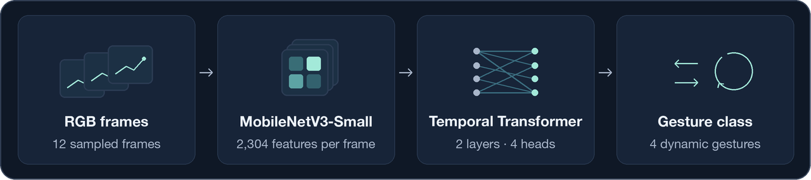

[← Back to profile](https://github.com/Leo700-bit)

# Video gesture recognition with CNN + Transformer

This PyTorch experiment classifies four arm and hand gestures from RGB video: left swipe, right swipe, clockwise circle, and counterclockwise circle. The goal was to test whether adding a temporal Transformer to frame-level CNN features helps recognize gestures across people.

## Dataset and evaluation split

The experiment uses 128 RGB clips from [UTD-MHAD](https://personal.utdallas.edu/~kehtar/UTD-MHAD.html), covering actions 1, 2, 9, and 10. Each of the eight participants contributed four trials per gesture. Participants were assigned to exactly one split.

| Split | Participants | Clips |
| --- | --- | ---: |
| Train | 1, 3, 5 | 48 |
| Validation | 7 | 16 |
| Test | 2, 4, 6, 8 | 64 |

## Model pipeline

1. **Sample frames.** OpenCV decodes each video and samples 12 evenly spaced frames at 192 × 144 pixels.
2. **Cache CNN features.** A frozen, pretrained MobileNetV3-Small encodes each frame. Adaptive 2 × 2 spatial pooling yields one 2,304-dimensional feature vector per frame. These vectors are cached so the temporal head can train without re-encoding videos.
3. **Classify the sequence.** The model projects each vector to 128 dimensions, adds learned temporal positions, and applies a two-layer Transformer with four attention heads. Temporal mean pooling and a linear layer produce four class logits. The saved checkpoint was selected by validation loss.

## Held-out results

These are measurements from the local experiment on the 64 test clips. Shuffled-frame accuracy is averaged over ten seeded frame permutations of the saved Transformer checkpoint.

| Method | Test accuracy | Macro F1 |
| --- | ---: | ---: |
| Mean-pooled CNN features with cosine class prototypes | 22/64 (34.4%) | 0.315 |
| CNN + temporal Transformer | 20/64 (31.2%) | 0.313 |
| YOLO wrist trajectories with a ridge classifier | 18/64 (28.1%) | 0.260 |
| Transformer with shuffled frame order | 29.8% | — |

Frame shuffling changed 2.5% of predictions on average. Mean pooling scored slightly higher than the Transformer on this split, and the small response to shuffling suggests the saved model relied only weakly on frame order.

Transformer confusion matrix

Rows are actual gestures and columns are predictions.

| Actual gesture | Left swipe | Right swipe | Clockwise | Counterclockwise |
| --- | ---: | ---: | ---: | ---: |
| Left swipe | 3 | 1 | 7 | 5 |
| Right swipe | 0 | 6 | 7 | 3 |
| Clockwise circle | 4 | 0 | 8 | 4 |
| Counterclockwise circle | 3 | 2 | 8 | 3 |

